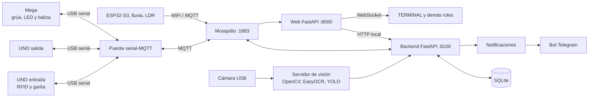

## Propósito y objetivos

PORTUS Fase 3 amplía la terminal física y la plataforma de Fase 2 con percepción ambiental y visión por computadora. La estación meteorológica mide temperatura, humedad, lluvia y luz. El servidor transforma esas lecturas en decisiones sobre la grúa y la iluminación. La cámara aporta lectura de placas en la garita y detección de vehículos en la zona de espera.

Los objetivos técnicos son:

- Medir el entorno desde una estación ESP32-S3 independiente, alimentada por separado y conectada por WiFi y MQTT.
- Suspender la grúa durante la lluvia y reanudarla después de un intervalo continuo sin lluvia.
- Controlar la iluminación de la planta con histéresis y encenderla durante la captura de placas.
- Verificar el ingreso mediante la correspondencia entre RFID y placa, además de las reglas documentales y de cita.
- Registrar fotografías, decisiones, retenciones, alarmas y acciones del operador.
- Mostrar el clima y la visión en la plataforma y ofrecer la consulta `/clima` al transportista.

## Alcance implementado

| Subsistema             | Función                                                                                                                          |
| ---------------------- | -------------------------------------------------------------------------------------------------------------------------------- |
| Estación meteorológica | ESP32-S3, sensor de lluvia YL-83 y LDR. Publica mediciones y latidos por MQTT.                                                   |
| Control climático      | El backend ordena suspensión por lluvia, mide el tiempo sin lluvia y ordena reanudación automática.                              |
| Iluminación            | El Mega conmuta la tira LED. El backend decide entre modo automático, encendido forzado y apagado forzado.                       |
| Baliza                 | El Mega hace parpadear el LED ámbar durante la suspensión climática mediante `millis()`.                                         |
| Visión de garita       | La cámara captura por evento y EasyOCR lee una región configurable de la imagen.                                                 |
| Identidad              | El servidor compara la placa con el vehículo asociado al UID RFID y consulta las placas restringidas.                            |
| Conteo de fila         | Un detector YOLO COCO identifica automóvil, autobús y camión en la región de espera. El umbral alimenta la alarma de congestión. |
| Plataforma             | TERMINAL incorpora Accesos y controles de clima e iluminación. AUTORIDAD administra placas restringidas.                         |
| Mensajería             | El bot incorpora `/clima` y notificaciones de suspensión, reanudación e ingreso con fotografía.                                  |

La cadena operativa heredada conserva manifiestos, declaraciones, levantes, citas, turnos, pesaje, grúa, patio, retenciones, reportes y los cinco roles.

## Arquitectura y distribución física

### Controladores y relación entre módulos



La estación mide y publica. El backend decide clima, iluminación y acceso. El puente convierte mensajes MQTT en tramas seriales PORTUS. Los microcontroladores ejecutan los comandos y mantienen las temporizaciones y señales físicas. La cámara está conectada directamente al servidor.

### Disposición de la maqueta

La cámara se fija con vista a la garita y a la zona de espera. La lectura de placa utiliza una región de interés de la garita. El conteo utiliza otra región para la fila. La iluminación cubre las zonas de operación y la baliza ámbar se coloca sobre la grúa. El sensor de lluvia se instala inclinado para escurrir agua y la estación dispone de carcasa ventilada y alimentación independiente.

### Flujo vehicular

1. NAVIERA crea el manifiesto. AGENTE presenta declaración y solicita levante. AUTORIDAD resuelve el levante.
2. El transportista gestiona su cita. En la garita se lee el UID RFID y se toma una fotografía.
3. El servidor lee la placa, compara ambos identificadores, consulta restricciones y aplica las reglas documentales.
4. El resultado se comunica al UNO de entrada. Según la decisión se abre la talanquera, se solicita intervención del operador o se registra un rechazo.
5. El vehículo pasa por pesaje, transferencia, grúa y patio o retiro. Las retenciones por placa se aplican después del pesaje de entrada.
6. La salida se valida mediante el flujo de Fase 2 y se cierra el turno.

## Hardware y conexiones

### Componentes

| Elemento                                    | Función                                                     |
| ------------------------------------------- | ----------------------------------------------------------- |
| ESP32-S3                                    | Nodo meteorológico con WiFi y alimentación propia.          |
| DHT22                                       | Temperatura en °C y humedad relativa en %.                  |
| YL-83 con comparador                        | Detección digital de lluvia. El nivel `LOW` equivale a lluvia. |
| LDR y resistencia de 10 kΩ                  | Medición analógica de luz, calibrada de 0 a 100.            |
| Arduino Mega 2560                           | Grúa, tira LED, baliza y señales de patio.                  |
| Arduino Uno de entrada y salida             | RFID, LCD, barreras, sensores y señalización de garitas.    |
| Tira LED y etapa MOSFET o relé              | Iluminación de la planta.                                   |
| LED ámbar                                   | Baliza visible en la grúa.                                  |
| Cámara USB o módulo de cámara               | Imágenes de garita y zona de espera.                        |
| Servidor Raspberry Pi o computadora central | Broker, backend, puente, web, bot y modelos de visión.      |

### Pines de la estación ESP32-S3

| Señal      | GPIO | Conexión |
| ---------- | ---: | ---------------------------------------------------------- |
| DHT22 DATA | 4 | Módulo a 3.3 V y GND. |
| YL-83 DO   | 9 | Salida digital del comparador. Alimentación a 3.3 V y GND. |
| LDR        | 10 | Divisor: 3.3 V → LDR → GPIO 10 → 10 kΩ → GND. |

La calibración `LUZ_RAW_OSCURO` y `LUZ_RAW_CLARO` convierte la lectura ADC a la escala de 0 a 100. La estación conserva los intervalos de publicación en la memoria no volátil `Preferences`.

### Pines del Mega para Fase 3

| Señal | Pin | Comportamiento |
| --- | ---: | --- |
| Tira LED | 24 | `HIGH` enciende mediante la etapa de potencia. |
| Baliza de grúa | 27 | Parpadeo con medio período de 500 ms durante suspensión por clima. |

El Mega mantiene las conexiones de grúa, electroimán, sensores ópticos, ultrasonido y cuatro posiciones de patio descritas en el manual de Fase 2.

### Enlaces y puertos

| Enlace | Uso |
| --- | --- |
| USB serial a 9600 baudios | UNO entrada, UNO salida y Mega hacia el puente. |
| WiFi + MQTT, puerto 1883 | Estación, backend, web y puente. |
| HTTP local, puerto 8100 | Backend FastAPI. |
| HTTP, puerto 8000 | Aplicación web. |
| WebSocket | Actualización en vivo de las interfaces. |

## Organización del software

| Ruta desde la raíz de `FASE3` | Función |
| --- | --- |
| `firmware/estacion_esp32/` | Lecturas, reconexión WiFi/MQTT y configuración persistente del ESP32-S3. |
| `firmware/mega_grua_pesaje/` | Control de la grúa, iluminación y baliza. |
| `firmware/uno_garita_entrada/`, `firmware/uno_garita_salida/` | Control local de accesos. |
| `bridge/` | Tramas seriales PORTUS y traducción MQTT. |
| `backend/app.py` | API, suscripciones MQTT, vigilancia de estación y coordinación de reglas. |
| `backend/estacion.py`, `backend/iluminacion.py` | Reglas de clima e iluminación. |
| `backend/camara_garita.py`, `backend/verificacion.py`, `backend/garita_verificacion.py` | Captura, OCR, decisión de acceso y registro. |
| `backend/conteo_fila.py` | Detección COCO y estado de congestión. |
| `backend/orquestador.py` | Convierte eventos físicos en operaciones persistentes y comandos. |
| `lector_placas.py` | EasyOCR, recorte de región, normalización y corrección de formato. |
| `web_c/` | Interfaces por rol, API web y WebSocket. |
| `bot_d/` | Consultas y notificaciones por Telegram. |
| `run_all.sh`, `status_all.sh`, `stop_all.sh` | Inicio, revisión y detención de servicios. |

### Dependencias principales

Python 3, FastAPI, Uvicorn, SQLAlchemy, SQLite, Paho MQTT, PySerial, OpenCV, EasyOCR, NumPy y Ultralytics YOLO. El ESP32 usa `WiFi`, `PubSubClient`, `DHT` y `Preferences`. El firmware de las garitas y la grúa utiliza las bibliotecas Arduino de sus respectivos periféricos.

## Modelo de datos y comunicación

### Entidades persistentes

El modelo de Fase 2 conserva usuarios, transportistas, vehículos, manifiestos, declaraciones, citas, turnos, posiciones de patio, retenciones, alarmas, auditoría, notificaciones y reportes. Fase 3 incorpora:

| Entidad | Datos principales |
| --- | --- |
| `LecturaPlaca` | UID, placa leída, confianza, resultado, causa, ruta de foto, turno asociado, estado pendiente y decisión del operador. |
| `PlacaRestringida` | Placa, motivo, usuario, fecha de restricción, estado activo y datos de liberación. |

La información reciente de la estación y el estado de iluminación se ofrecen mediante la API. El estado climático también se guarda como configuración para la respuesta del bot.

### Protocolo serial PORTUS

El puente mantiene el protocolo de Fase 2: tramas delimitadas con emisor, secuencia, tipo, datos y verificación de integridad. Los eventos de RFID y sensores llegan al servidor por `portus/evt/#`. Los comandos salen por `portus/cmd/solicitud`. Las respuestas regresan por `portus/cmd/respuesta`.

Comandos relevantes de esta fase: `GruaSuspender` con `motivo=Clima`, `GruaReanudar` con `origen=auto`, `IluminacionEncender`, `IluminacionApagar` y `GaritaResultado` con las dos líneas de pantalla.

### Tópicos MQTT de Fase 3

| Tópico | Emisor | Datos |
| --- | --- | --- |
| `portus/estacion/lectura` | ESP32-S3 | `temperatura`, `humedad`, `lluvia`, `luz`, `ts`, `uptime_s`. |
| `portus/estacion/estado` | ESP32-S3 | Estado, identificador, RSSI y tiempo encendido. |
| `portus/estacion/config` | Backend | `SegundosLecturaEstacion` y `SegundosLatidoEstacion`. |
| `portus/vision/placa` | Backend | UID, placa, confianza, resultado, causa y referencia de foto. |
| `portus/vision/estado` | Backend | Estado de cámara y modelos. |
| `portus/vision/cola` | Servidor de visión | Cantidad de vehículos en espera. |
| `portus/evt/clima` | Backend | Inicio o fin de suspensión por lluvia. |
| `portus/evt/iluminacion` | Controlador | Estado de iluminación y modo. |

Ejemplo de lectura ambiental:

```json
{"temperatura": 24.1, "humedad": 61.3, "lluvia": false, "luz": 42, "ts": 1792800000, "uptime_s": 360}
```

## Control de acceso y salida

### Entrada con RFID y placa

El UID RFID identifica al vehículo registrado. La cámara toma la imagen por evento de garita. EasyOCR lee la placa y entrega texto y confianza. El servidor normaliza mayúsculas y espacios, exige la confianza configurada y acepta coincidencia exacta o diferencia de un carácter cuando esta corresponde a una única placa del catálogo. La restricción aduanera tiene prioridad sobre la coincidencia normal.

| Resultado | Acción |
| --- | --- |
| RFID y placa del mismo vehículo | Se aplican las validaciones de manifiesto, levante y cita. Se autoriza el ingreso. |
| Placa de otro vehículo | Se genera AL20. RT07 se aplica después del pesaje y corresponde a TERMINAL. |
| Placa restringida | Se genera AL21. RT08 se aplica después del pesaje y corresponde a AUTORIDAD. |
| RFID desconocido | Se rechaza el intento en garita. |
| Lectura no válida tras los intentos | Se genera AL22 y el operador decide desde Accesos con fotografía y motivo. |
| Cámara o modelo fuera de servicio | Se genera AL18 y el operador confirma cada ingreso en modo degradado. |

La pantalla recibe los textos `LEYENDO PLACA`, `PLACA VERIFICADA`, `PLACA NO COINCIDE`, `PLACA RESTRINGIDA`, `VERIFICACION MANUAL`, `ACCESO DENEGADO` o `MODO DEGRADADO`, según el caso. Las decisiones manuales requieren motivo de al menos diez caracteres.

### Placas restringidas y auditoría

AUTORIDAD registra y libera placas desde su pestaña «Placas restringidas». El motivo de cada acción debe contener al menos diez caracteres. La lista se consulta en cada intento y las altas, liberaciones y decisiones manuales quedan auditadas. RT07 y RT08 permiten «Aclarar» o «Rechazar».

### Interfaces y salida

TERMINAL dispone de Operación, Turnos, Accesos, Retenciones, Patio, Grúa, Alarmas, Citas y Reportes. Accesos reúne verificaciones pendientes, historial de lecturas con fotografías y catálogo de vehículos. NAVIERA, AGENTE y AUTORIDAD conservan sus vistas documentales. AUTORIDAD suma la administración de placas. El transportista usa el bot de Telegram. La garita de salida mantiene la verificación RFID y cierre de turno de la fase anterior.

## Grúa, depósito e inventario

### Suspensión y reanudación por lluvia

Cuando la estación reporta lluvia, el backend envía `GruaSuspender` con motivo `Clima`, registra el cambio y genera AL17. La grúa finaliza el movimiento en curso y queda suspendida antes de tomar otro trabajo. La baliza parpadea mientras dura esta suspensión. El control de reanudación manual se deshabilita en la web durante la suspensión climática.

Cuando cesa la lluvia, el backend cuenta `MinutosSinLluviaReanudar` minutos continuos. Una nueva lectura de lluvia reinicia el conteo. Cumplido el tiempo, envía `GruaReanudar` con origen automático y la baliza se apaga. La garita, el pesaje y la salida mantienen sus flujos operativos.

### Depósito, retiro e inventario

La grúa conserva la cola de trabajos, el referenciado, las posiciones P1 a P4, los ciclos de depósito y retiro y las confirmaciones físicas que actualizan el inventario. Los turnos y ciclos siguen registrando eventos para la vista de TERMINAL y los reportes. La suspensión climática se refleja en el estado operativo y en las notificaciones a los transportistas afectados.

## Pesaje, retiro, remociones y cola de trabajos

El UNO de entrada procesa la secuencia de garita y pesaje. El backend vincula los eventos con un turno y aplica las reglas de peso, desvío y retención de Fase 2. Las causas RT07 y RT08, determinadas en la verificación de placa, pasan a la bandeja de retenciones al completarse el pesaje de entrada. Desde ahí se sigue el flujo de plaza, resolución y notificación correspondiente al rol facultado.

Los trabajos de depósito y retiro conservan su orden, remociones y confirmación física. La cola de vehículos de espera se mide visualmente con el detector COCO: se cuentan las clases automóvil, autobús y camión. La lectura de placa tiene prioridad frente al conteo. Al alcanzar `UmbralCola` se activa la condición de congestión AL19. Al descender, se da por superada.

## Temporización, seguridad y errores

### Parámetros de Fase 3

| Parámetro | Defecto | Rango | Función |
| --- | ---: | ---: | --- |
| `SegundosLecturaEstacion` | 5 s | 2–60 s | Frecuencia de medición publicada. |
| `SegundosLatidoEstacion` | 10 s | 5–60 s | Latido de la estación. |
| `MinutosSinLluviaReanudar` | 2 min | 1–30 min | Tiempo seco para reanudar grúa. |
| `UmbralLuzEncendido` | 30 | 0–95 | Enciende al descender por debajo. |
| `UmbralLuzApagado` | 45 | 5–100 | Apaga al superar el valor. |
| `ConfianzaMinimaOCR` | 60 % | 30–95 % | Confianza requerida para lectura. |
| `IntentosOCR` | 3 | 1–5 | Fotografías por intento de lectura. |
| `SegundosEsperaVerificacion` | 10 s | 5–30 s | Espera de decisión en garita. |
| `SegundosConteoCola` | 5 s | 2–30 s | Intervalo de conteo visual. |
| `UmbralCola` | 3 | 1–10 | Cantidad que marca congestión. |

`UmbralLuzApagado` debe superar a `UmbralLuzEncendido` por al menos cinco unidades. En modo automático, el estado se conserva entre ambos umbrales para evitar parpadeos. Los modos forzados mantienen su estado hasta un cambio de modo. Para capturar una placa, la iluminación se enciende un segundo antes de la fotografía y después retorna al modo vigente.

### Vigilancia y alarmas

| Código | Condición | Severidad |
| --- | --- | --- |
| AL16 | Estación sin comunicación tras tres períodos de latido. | Alta |
| AL17 | Lluvia y suspensión de grúa. | Media |
| AL18 | Cámara o modelo fuera de servicio. | Alta |
| AL19 | Congestión de fila. | Media |
| AL20 | Placa distinta a la del RFID. | Alta |
| AL21 | Placa restringida en garita. | Crítica |
| AL22 | Se requiere verificación manual. | Media |

Al perder la señal de la estación, el servidor registra AL16, conserva el estado actual de la grúa y ordena encender la planta. La estación sigue midiendo y reintenta la conexión WiFi y MQTT. El Mega mantiene la iluminación encendida al perder su enlace con el servidor. Si la cámara falla, la garita pasa a modo degradado y cada ingreso requiere decisión del operador.

## Compilación, carga y puesta en marcha

### Preparación

1. Instalar Arduino IDE con soporte **ESP32S3 Dev Module** y las bibliotecas `PubSubClient`, `DHT sensor library` y `Adafruit Unified Sensor`.
2. Configurar en el firmware de la estación el SSID, la clave WiFi, el host MQTT y los valores de calibración del LDR para el entorno de despliegue.
3. Cargar `estacion_esp32.ino` en el ESP32-S3. Usar monitor serial a 115200 baudios para verificar lecturas y conexiones.
4. Cargar los firmwares de UNO entrada, UNO salida y Mega. Conectar sus puertos USB al servidor.
5. Instalar las dependencias de `backend/`, `bridge/`, `web_c/`, `bot_d/` y las de visión indicadas en `requirements.txt` o `requirements_pi.txt`.
6. Colocar la cámara fija, ajustar el encuadre y configurar `PORTUS_ROI` para la región donde aparece la placa. Calibrar por separado la región de conteo de la fila.

### Configuración de ejecución

| Variable | Uso |
| --- | --- |
| `PORTUS_MQTT_HOST`, `PORTUS_MQTT_PORT` | Broker al que se conectan los servicios. |
| `UNO_ENTRADA_PORT`, `UNO_SALIDA_PORT`, `MEGA_GRUA_PORT` | Puertos seriales de los tres controladores. |
| `PORTUS_SECRET_KEY` | Firma de sesiones web. |
| `PORTUS_BOT_TOKEN` | Conexión del bot de Telegram. |
| `PORTUS_VERIFICACION_PLACA=1` | Activa la decisión RFID + placa en la garita. |
| `PORTUS_INDICE_CAMARA` | Índice de cámara usado por OpenCV. |
| `PORTUS_ROI` | Recorte de placa en fracciones `x,y,w,h` de 0 a 1. |
| `PORTUS_CONFIANZA_MINIMA_OCR`, `PORTUS_INTENTOS_OCR` | Regla de aceptación y reintentos de OCR. |
| `PORTUS_MODELO_COCO` | Ruta del modelo YOLO COCO para conteo. |

Desde la raíz de FASE3, `bash run_all.sh` inicia los servicios. `bash status_all.sh` muestra su estado y `bash stop_all.sh` los detiene. La web se atiende en el puerto 8000 y el backend en `127.0.0.1:8100`. Los registros de los procesos se guardan en `.runtime/logs/`.

### Comprobaciones operativas

- Suscribirse con `mosquitto_sub -t 'portus/estacion/#' -v` y observar lecturas y latidos.
- Mojar el YL-83 y comprobar la orden climática, la baliza, AL17 y el estado de la web. Secarlo y observar la reanudación temporizada.
- Cubrir y descubrir el LDR y verificar el cambio de iluminación sin conmutaciones repetidas.
- Presentar un vehículo registrado y revisar la lectura de placa, el resultado de garita y la fotografía en Accesos.
- Usar `/clima` en Telegram para consultar temperatura, humedad, lluvia y estado de la grúa.

## Calibración y mantenimiento

### Estación meteorológica

Con el LDR cubierto y luego iluminado, registrar las lecturas ADC y ajustar `LUZ_RAW_OSCURO` y `LUZ_RAW_CLARO`. Verificar que el valor publicado disminuya hacia 0 en oscuridad y aumente hacia 100 con luz intensa. Ajustar el comparador del YL-83 y confirmar que la salida digital cambia al mojar y secar la placa. 

### Cámara y reconocimiento

Fijar el soporte antes de calibrar la región de interés. Ajustar `PORTUS_ROI` con la placa centrada en la fotografía y caracteres nítidos. `lector_placas.py` permite revisar el recorte y la imagen ampliada de diagnóstico. La placa esperada se imprime en alto contraste, con formato comercial de una letra, tres dígitos y tres letras. Para medir la tasa de acierto, registrar al menos veinte capturas con texto esperado, texto leído, confianza y resultado.

### Iluminación, grúa y garitas

Revisar continuidad de la tira LED, etapa de potencia y baliza. Comprobar que la baliza solo parpadee durante suspensión por clima. Verificar el retorno del modo de iluminación después de cada captura. Mantener la calibración de pesaje, sensores, servos, finales de recorrido y posiciones de grúa descrita en los manuales anteriores.

## Bitácora de desarrollo

La secuencia técnica de integración de Fase 3 queda organizada en estos hitos:

1. **Estación:** programación ESP32-S3, conexión MQTT y prueba de reconexión.
2. **Clima e iluminación:** reglas de suspensión y reanudación, tres modos de iluminación, histéresis, baliza y vigilancia del enlace.
3. **Visión:** instalación de cámara, definición de regiones de interés, lectura EasyOCR y conteo YOLO COCO.
4. **Accesos:** comparación RFID + placa, restricciones aduaneras, retenciones RT07/RT08, decisiones manuales y fotografías.
5. **Plataforma y bot:** vista Accesos, panel de clima, placas restringidas, comando `/clima` y avisos a transportistas.
6. **Validación integrada:** pruebas de lluvia, luz, ingreso correcto, placa ajena, placa restringida, captura difícil, congestión y recuperación de enlaces.
